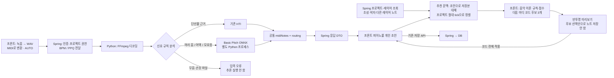

# 녹음의 자동 MIDI 변환

녹음 화면의 기본 `자동 판별`은 추가 학습 모델 없이 Python의 신호 규칙으로 변환 엔진을 선택한다.
`허밍 · 한 음씩` / `악기 · 화음`은 사용자가 판단을 수정하는 입력 옵션이며 MIDI 재생 악기와 별개다.
변환 결과의 이유를 피아노롤 상태 줄에 표시하고 기존 개인 초안·저장 흐름을 사용한다.

[벡터 다이어그램](AUTO_MIDI_ROUTING.svg)

다이어그램은 이번 자동 변환과 기존 코드 추천을 함께 적용한 구조다. 코드 추천은 별도
[프론트 PR #111](https://github.com/Team-Glitched/narackrock_frontend_v1/pull/111),
오디오 분석 데이터 연결은 [백엔드 PR #129](https://github.com/Team-Glitched/narackrock-backend-v1/pull/129)의 기능이다.
이번 브랜치는 추천 규칙을 다시 구현하거나 변경하지 않는다. 추천 계산은 현재 프론트에서 수행한다.

## 저장소별 변경

- 프론트: `soundKind=AUTO` multipart 전송, 변환 방식 수정 옵션, 모델에 종속되지 않는 버튼명,
  웹·앱 공통 녹음 훅, 판별 이유 표시. 노트 형식과 동시 음을 유지한다.
- Spring: 기존 `/api/v1/projects/{projectId}/hti-transform`에 `soundKind` 추가(생략 시 AUTO),
  기존 권한 검증 후 Python에 전달한다. `routing`을 응답하며 Python의 422를 입력 오류로 구분한다.
  Uvicorn 호환을 위해 추론 요청은 HTTP/1.1과 연결/응답 제한 시간을 사용한다.
- Python: 전체 녹음에 대한 배음 묶음·자기상관 주기성·어택/감쇠·지속 다중음 근거를 분석한다.
  선택된 모델 하나만 실행하고 공통 노트 JSON을 반환한다. 악기 워커 실패 시 HTI로 대체하지 않는다.

Python에는 앞서 구현한 Basic Pitch 별도 환경이 필요하다. 기본 Docker 이미지에 이를 포함하며,
기존 HTI 체크포인트의 비상업 연구·평가 조건은 유지된다. 이번 작업은 로컬 검증이며 운영 배포는 하지 않았다.

## 검증 (2026-11-18)

- 프론트 303개 테스트, 타입 검사, 네이티브 타입 검사, lint, 빌드 통과.
- Spring 1228개 테스트 통과. Python 59개 테스트 통과.
- 합성 신호: 배음이 강한 단일 음, 순차 단선율, 장·단화음, 단일 감쇠음, 긴 단선율 뒤의 화음,
  마지막 160ms의 짧은 화음, 무음·DC·비정상 값·잡음. 단일 엔진 실행과 화음 보존을 검사했다.
- 실제 HTI 체크포인트와 Basic Pitch ONNX를 실행한 Spring→Python 통합 요청:
  합성 단선율은 HTI, 합성 C·E·G 화음은 Basic Pitch로 분기했다.
- 브라우저에서 실제 MediaRecorder에 테스트 오디오 스트림을 공급해 녹음 시작→종료→자동 판별
  →재생 악기 선택→피아노롤→저장까지 조작했다. C·E·G가 동시에 남는 것과 저장된 MIDI 클립을 확인했다.
  사용자의 실제 마이크나 음성은 수집하지 않았다. 모바일 실기기는 실행하지 않았다.
- 공개 실제 보컬 3개(개발 확인용, 임계값 조정에 사용): 2개 HTI / 1개 모호함으로 Basic Pitch.
  규칙 고정 후 다른 보컬 3개: 2개 HTI / 1개 모호함으로 Basic Pitch.
- 실제 피아노 녹음의 8초 구간은 모호함으로 Basic Pitch를 선택했다. Spring을 거쳐 61개 이벤트가
  반환됐다. 실제 보컬 q1은 HTI로 33개, 모호한 q100은 Basic Pitch로 44개 이벤트가 반환됐다.

샘플 출처: [MTG-QBH](https://www.upf.edu/web/mtg/mtg-qbh) q1/q10/q100(개발), q101/q102/q103(추가 확인).
내부 비상업적 평가에만 사용했고 원본은 저장소에 넣지 않았다.
피아노는 [librosa 예제](https://librosa.org/doc/main/recordings.html)의 The Piano Lady / Lena Orsa,
“Pistachio Ice Cream Ragtime”이다. 코드에 샘플별 예외나 파일명 판정은 없다.

## 한계

이 결과는 소수 샘플의 기능·분기 검증이며 일반적인 분류 정확도나 음정 전사 정확도가 아니다.
피아노의 단일 음, 배음 관계의 화음(옥타브 등), 잔향, 비브라토, 잡음·반주 혼합에서 구분이 모호할 수 있다.
모호하면 Basic Pitch를 한 번만 실행하고 이유를 표시한다. 사용자가 변환 방식을 수정할 수 있다.
합성 음의 HTI 전사에서 옥타브 오류, Basic Pitch에서 추가 저음 이벤트도 관찰했다.
따라서 자동 판별 성공과 MIDI 음높이의 정확성을 같은 것으로 보지 않는다.
